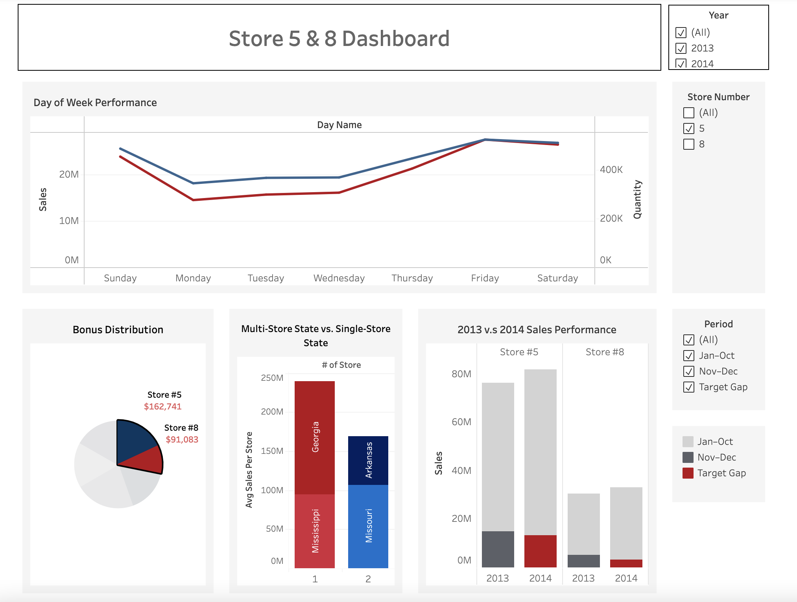
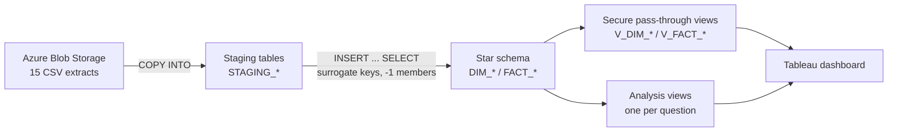
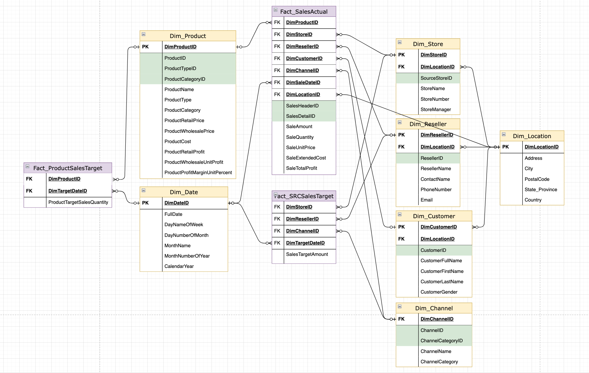
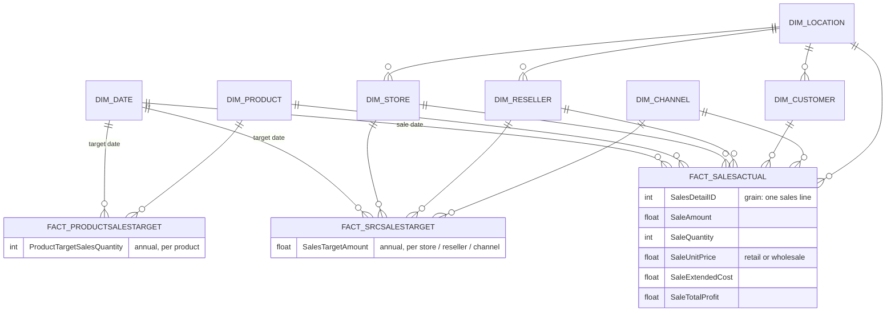

# Retail Sales Data Warehouse on Snowflake

An end-to-end BI build for a multi-channel retailer. Fifteen raw CSV extracts are loaded into Snowflake, modelled into a star schema with surrogate keys and unknown members, exposed through a secure view layer, and analysed in a Tableau dashboard that answers four questions from management about store performance, bonuses and expansion.

**Skills shown:** dimensional modelling (Kimball star schema) · Snowflake SQL · ELT from Azure Blob Storage · data quality checks · secure views as a data access layer · Tableau dashboarding

---

## 📌 At a glance

| | |
|---|---|
| **Source** | 15 CSV files (sales headers and lines, products, stores, resellers, customers, channels, targets) |
| **Model** | 7 dimensions + 3 fact tables at three different grains |
| **Layers** | Azure Blob → staging → star schema → secure views → Tableau |
| **Outputs** | 4 analysis views, one interactive dashboard, a bonus allocation and a store recommendation |
| **Context** | Built as a course project, then organised into ordered, reviewable scripts |



**[▶ Open the interactive dashboard on Tableau Public](https://public.tableau.com/app/profile/ching.ping.chan/viz/9_13AssignmentVisualization_17488860056310/Dashboard1)**

### Key findings

- **Keep both stores open.** Stores 5 and 8 both grew in 2014, and a normal holiday season closes their remaining gap to target.
- **Bonus split:** store 5 earns $162,741 and store 8 earns $91,083 of the Men's and Women's Casual bonus pools.
- **Weekly pattern:** sales peak Friday–Saturday and drop by about half on Monday.
- **Expansion:** stores alone in their state average ≈ $120M versus ≈ $85M in two-store states, so new states come before a second store.

Details and method for each question are in [Business questions and findings](#-business-questions-and-findings).

---

## 🏗 Architecture



## ⭐ Star schema



<details>
<summary>Same model as a Mermaid diagram, with fact table grains</summary>



</details>

### Design decisions

- **Surrogate keys everywhere.** Each dimension uses an `IDENTITY` key and keeps the source ID as a separate attribute, so the warehouse doesn't depend on source keys.
- **Unknown members (`-1`).** Every dimension has a `-1 / 'Unknown'` row and fact loads use `COALESCE(key, -1)`. A sale with no reseller or customer still joins, and the null checks in `04_facts.sql` confirm no fact row has a null key.
- **One shared `DIM_LOCATION`.** Stores, resellers and customers all have addresses, so they share one location dimension (built with a `UNION` of the three sources) instead of repeating address columns.
- **Derived measures in the model.** `DIM_PRODUCT` stores retail and wholesale unit profit and margin. `FACT_SALESACTUAL` picks the retail or wholesale price depending on whether the sale went through a reseller, so profit is correct per channel.
- **Source cleanup before loading facts.** Sale dates arrived as year `0013`/`0014` and were shifted to 2013/2014. Store names were missing in the source and are generated from the store number. `On-line` was normalised to `Online` so targets match channels.
- **Secure views as the only BI entry point.** Tableau reads `V_*` views, never base tables, so the model can change without breaking the dashboard and the view definitions stay hidden from consumers.

---

## 📊 Business questions and findings

*Values marked ≈ are read off the dashboard; exact figures come from the views in `sql/06_analysis_views.sql`.*

### 1. How are stores 5 and 8 doing, and will they hit their 2014 targets?
`SALES_FORECAST` compares year-to-date 2014 sales (Jan–Oct) with the annual target and uses each store's Nov–Dec 2013 sales as a benchmark for the rest of the year.

- Store 5 is the larger store, selling about 2.5× as much as store 8 (≈ $76M vs ≈ $30M in 2013). Both stores grew in 2014.
- Store 5 still needs ≈ $13M to reach its 2014 target. It made ≈ $15M in Nov–Dec 2013.
- Store 8 still needs ≈ $3M and made ≈ $4M in Nov–Dec 2013.
- **Recommendation:** if the holiday season repeats, both stores reach target, so the data doesn't support closing either one. Store 8's gap is small in absolute terms, but it is the store to watch.

### 2. How should the bonus pools be split?
`MENS_WOMENS_CASUAL_BONUS` gives each store a share of the pool ($500K in 2013, $400K in 2014) equal to its share of Men's and Women's Casual sales that year, using window functions over the yearly total.

- Across both years, **store 5 earns $162,741 and store 8 earns $91,083**. The rest of the pool goes to the other stores in proportion to their sales.

```sql
-- From MENS_WOMENS_CASUAL_BONUS: each store's share of the year's sales, applied to that year's pool
SUM(SA.SALEAMOUNT) * 1.0 / SUM(SUM(SA.SALEAMOUNT)) OVER (PARTITION BY D.YEAR) AS CONTRIBUTION_PCT,
CASE
  WHEN D.YEAR = 2013 THEN SUM(SA.SALEAMOUNT) * 1.0 / SUM(SUM(SA.SALEAMOUNT)) OVER (PARTITION BY D.YEAR) * 500000
  WHEN D.YEAR = 2014 THEN SUM(SA.SALEAMOUNT) * 1.0 / SUM(SUM(SA.SALEAMOUNT)) OVER (PARTITION BY D.YEAR) * 400000
END AS BONUS_AMOUNT
```

### 3. What do sales look like by day of the week?
`STORE_5_8_WEEK_SALES` aggregates sales and units by weekday, store and product.

- Sales peak on **Friday and Saturday** and bottom out on **Monday**. At store 5 (shown in the screenshot), Monday brings in ≈ $14M against ≈ $28M on Friday, about half. Sunday is also strong.
- **Recommendation:** staff and stock for the Fri–Sun peak, and use early-week promotions to lift Monday to Wednesday.

### 4. Do states with more than one store perform better?
`STATE_STORE_PERFORMANCE` computes average sales per store for each state and year.

- Stores that are the only one in their state average ≈ $120M each (Georgia, Mississippi).
- Stores in two-store states average ≈ $85M each (Missouri, Arkansas).
- **Takeaway:** a second store in the same state shows signs of cannibalisation. Expansion should go into new states before adding stores to existing ones.

---

## 🗂 Repository

```
sql/
├── 00_setup_and_load.sql      database, file format, stages, COPY INTO
├── 01_staging_tables.sql      15 staging tables
├── 02_dim_date.sql            generated calendar + fiscal date dimension
├── 03_dimensions.sql          location, store, reseller, customer, channel, product
├── 04_facts.sql               sales actuals and two target facts, with null-key checks
├── 05_secure_views.sql        pass-through data access layer
├── 06_analysis_views.sql      one view per business question
└── checks/
    └── staging_smoke_tests.sql
docs/
├── dashboard.png
└── erd.png
```

## ▶️ How to run it

Snowflake is a cloud service, so there is nothing to install locally.

1. **Get a Snowflake account.** A free trial works. Open a SQL worksheet and pick a warehouse (`USE WAREHOUSE COMPUTE_WH;`).
2. **Create the database and staging tables.** Run the database and file-format part of `00_setup_and_load.sql`, then `01_staging_tables.sql`.
3. **Load the CSVs.** Point the stages in `00_setup_and_load.sql` at your Azure Blob container (account, container, SAS token) and run the `COPY INTO` statements. If you don't use Azure, an internal stage works too: upload the files in the Snowflake UI, as was done here for `Segment.csv`.
4. **Build the model.** Run `02_dim_date.sql` → `03_dimensions.sql` → `04_facts.sql`. The null-key checks at the end of `04` should all return 0.
5. **Expose it.** Run `05_secure_views.sql` and `06_analysis_views.sql`.
6. **Connect Tableau.** Use the Snowflake connector in Tableau and select the `V_*` and analysis views, not the base tables.

## 🧭 Known limitations and next steps

- Annual targets are stored on every day of the target year, so views read them back with `AVG` instead of `SUM`. Allocating the target per day, or keying it to a year-level date, would make it safe to aggregate.
- Store names aren't in the source and are generated as `Store Number N`.
- `DIM_DATE` covers only 2013–2014, the span of the data.

## 💻 Tech stack

Snowflake · SQL · Azure Blob Storage · Tableau
